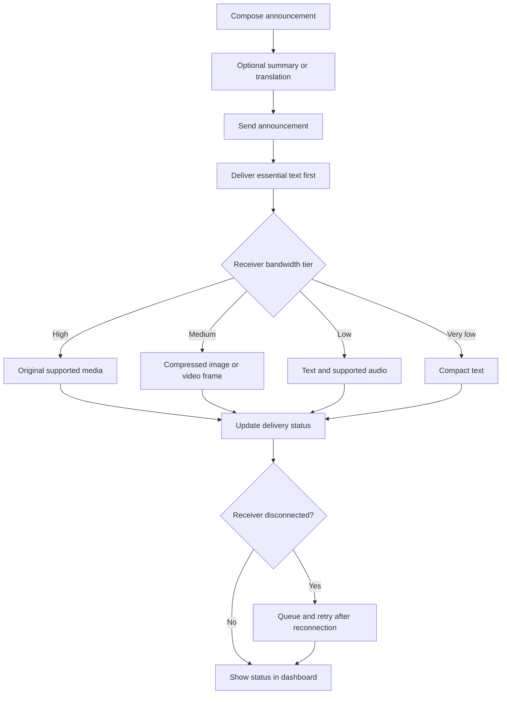

<div align="center">

# PulseCast Adaptive

### Intelligent, bandwidth-aware announcements for unreliable networks

**One announcement. Multiple delivery formats. Clear delivery visibility.**

PulseCast Adaptive is a prototype communication platform that adapts announcement content to each receiver's simulated network capacity, combines AI-assisted summaries and translations, and helps operators track delivery and recover missed alerts.

<p>
  
  
  
  
  
</p>

</div>

---

## Why PulseCast?

During an urgent situation, not every recipient has the same connection. Sending a large image or video to someone on a weak network can delay useful information.

PulseCast explores a different approach: **send the essential text first, then adapt supporting content to each receiver's available capacity.** Operators can inspect the selected delivery format, connection state, and whether a missed alert is waiting for recovery.

> **Prototype note:** bandwidth and receiver connectivity are simulated in the current demo. They are not measurements of a recipient's actual mobile network, and this project is not a certified public-warning system.

## Highlights

| Feature | What it does |
|---|---|
| **Adaptive delivery** | Chooses text, audio, original media, or compressed media according to each receiver's configured bandwidth tier. |
| **Text-first announcements** | Sends the essential text before supporting media, so the core message is not dependent on a large attachment. |
| **AI-assisted summaries** | Uses the optional Groq integration to shorten long announcements while checking for numbers and times that may have been omitted. |
| **English and Tamil support** | Provides reviewed bilingual templates and optional AI-assisted translation. Translation remains editable before sending. |
| **Live reachability** | Separates receiver connection status from announcement delivery and acknowledgement status. |
| **Missed-alert recovery** | Queues eligible alerts for disconnected receivers and retries after reconnection, within a bounded retry limit. |
| **SMS notifications** | Can submit announcement text to configured recipients through a backend-only Twilio integration. Provider acceptance is distinct from handset delivery. |
| **QR utilities** | Generates QR codes locally and offers a separate recipient manager for individual demo QR codes. |
| **Delivery measurements** | Reports payload bytes and estimated savings against a high-tier baseline for completed deliveries. |

## How it works



## Adaptive delivery tiers

The current thresholds are defined in `backend/app/tiers.py`, the single source of truth for tier selection.

| Tier | Simulated capacity | Delivery plan |
|---|---:|---|
| **High** | ≥ 1,000 kbps | Text, audio, original image, original video |
| **Medium** | 300–999 kbps | Text, audio, image compressed to a 480 px JPEG, one compressed video frame |
| **Low** | 64–299 kbps | Text and audio; no images or video |
| **Very low** | < 64 kbps | Compact text only (about 160 characters); attachments are not sent |

Each receiver is handled independently, so a slow simulated connection does not hold up faster receivers. Actual media support depends on the uploaded format and browser capabilities.

## Dashboard and delivery states

PulseCast distinguishes these states rather than treating a successful send attempt as proof that a person read a message.

- **Connected / Disconnected** — whether a receiver currently has an active WebSocket connection.
- **Pending / Queued** — whether an announcement is waiting to be delivered.
- **Delivered** — the application has received the relevant delivery confirmation.
- **Acknowledged** — the receiver explicitly confirms the recovered announcement.
- **Failed** — delivery could not complete within the configured retry limit.

The current missed-alert queue and retry metadata are held in memory and are cleared when the backend restarts. The bounded text recovery history is separate.

## Technology

| Layer | Technology |
|---|---|
| Frontend | React 18, Vite, plain CSS, Recharts |
| Backend | Python, FastAPI, WebSockets |
| Media processing | Pillow for image compression |
| AI assistance | Groq API (optional; configured on the backend) |
| SMS channel | Twilio Python SDK (optional; credentials remain backend-only) |
| QR generation | `qrcode.react`; standard QR generation happens in the browser |
| Tests | Python `unittest` suite and frontend production build |

## Run the project

### Requirements

- Python 3.10+
- Node.js 18+
- Optional: Groq API key for AI summaries and translation
- Optional: Twilio account and eligible SMS sender for real SMS notifications

### 1. Configure the backend

From the project root:

```bash
cd backend
python -m venv .venv
```

Activate the virtual environment:

```powershell
# Windows PowerShell
.\.venv\Scripts\Activate.ps1
```

```bash
# macOS / Linux
source .venv/bin/activate
```

Install backend dependencies:

```bash
pip install -r requirements.txt
```

Create `backend/.env` from the provided example if needed:

```bash
# Run from the backend directory
copy .env.example .env
```

On macOS/Linux, use `cp .env.example .env`.

Add only the provider settings you intend to use. Example variable names:

```dotenv
GROQ_API_KEY=your_groq_api_key
GROQ_MODEL=llama-3.1-8b-instant

TWILIO_ACCOUNT_SID=your_twilio_account_sid
TWILIO_AUTH_TOKEN=your_twilio_auth_token
TWILIO_PHONE_NUMBER=your_twilio_sender_number
Kabil_number=+91XXXXXXXXXX
Monesh_number=+91XXXXXXXXXX
```

Replace placeholders with your own values. Do **not** commit `.env` or place provider secrets in frontend variables. Keep `.env` ignored by Git.

Start the backend:

```bash
uvicorn app.main:app --reload --port 8000
```

### 2. Start the frontend

Open a second terminal:

```bash
cd frontend
npm install
npm run dev
```

Open the development URL printed by Vite. The frontend proxies `/api` and `/ws` requests to the backend port configured in the Vite setup.

Camera and microphone capture are available on `localhost`; other hostnames generally require HTTPS for browser media permissions.

### 3. Run backend tests

From the `backend` directory, with the project's dependencies installed:

```bash
python -m unittest discover -s tests -v
```

Build the frontend:

```bash
cd frontend
npm run build
```

## Twilio SMS behavior

When Twilio is configured, the existing **Send Announcement** action can also submit the announcement text to the configured team recipients.

- SMS is sent from the backend; Twilio credentials are never sent to React.
- The dashboard reports results per recipient.
- **Accepted by Twilio** does not necessarily mean the handset received the message.
- Trial-account restrictions, sender eligibility, destination-country rules, and messaging registration may apply.
- Real SMS may incur charges. Automated tests should use mocked Twilio responses.

Local WebSocket broadcast status and SMS status are separate channels. An SMS failure should not be represented as a successful SMS delivery just because the local announcement was broadcast.

## AI summaries and translation

The optional Groq integration uses `GROQ_API_KEY` and optionally `GROQ_MODEL` from `backend/.env`. The key is read by the backend and is not returned to the frontend.

For very-low-bandwidth announcements, the summary workflow checks whether numbers and times from the original appear in the summary and warns about missing items. Review the summary before sending. If the provider is unavailable, the app can fall back to an extractive summary; translation requires a reviewed template or manually entered text when AI translation is unavailable.

## QR tools and security

The standard **QR Code Generator** is a local utility for announcement text, URLs, short strings, or code snippets. QR generation does not require an AI call.

The separate **Enter Recipient Details** manager can create an individual demo QR for each recipient. These codes use recipient metadata and an opaque, browser-generated token with an expiry; optional contact and demo credential fields are not encoded in the QR.

**Do not use this prototype to distribute real passwords or production credentials.** QR tokens are demo access data and should be shared carefully. Use an established password manager or secrets-management solution for real credentials.

## API and real-time interfaces

| Interface | Purpose |
|---|---|
| `GET /api/config` | Returns configuration metadata, tier rules, limits, and enabled-feature status |
| `POST /api/broadcast` | Broadcasts an announcement and supported attachments |
| `POST /api/summarize` | Returns an announcement summary and related warnings |
| `GET /api/announcements?since=N` | Returns text recovery history for reconnecting receivers |
| `POST /api/reset` | Resets in-memory demo counters |
| `WS /ws/receiver/{id}?kbps=N` | Receiver WebSocket; accepts bandwidth updates |
| `WS /ws/dashboard` | Live dashboard snapshots and receiver state |

The broadcast endpoint accepts multipart fields including `text`, `summary`, `image`, `audio`, `video`, `poster`, and `simulate_media_failure`. Check the current FastAPI route definitions for the exact schema before building another client.

## Project structure

```text
pulsecast-adaptive/
├── README.md
├── DEMO_SCRIPT.md
├── requirements.txt
├── backend/
│   ├── .env.example
│   ├── requirements.txt
│   ├── app/
│   │   ├── main.py
│   │   ├── hub.py
│   │   ├── tiers.py
│   │   ├── compact.py
│   │   ├── media.py
│   │   ├── ai.py
│   │   └── ...
│   └── tests/
└── frontend/
    ├── package.json
    └── src/
        ├── App.jsx
        ├── components/
        ├── hooks/
        └── lib/
```

## Current limitations

- **Simulated connectivity:** bandwidth is selected through controls and emulated with server-side delays; it is not actual network-speed measurement.
- **Single-process demo state:** receiver state, counters, and recovery queue metadata are held in memory and reset on backend restart.
- **Video adaptation:** medium tier uses a compressed frame rather than full video transcoding.
- **Recovery accounting:** recovery traffic over HTTP is not included in the WebSocket byte counters.
- **Not a certified emergency system:** do not rely on this prototype as the sole channel for life-critical public warnings.

## Troubleshooting

| Issue | What to check |
|---|---|
| Backend unreachable | Confirm the FastAPI process is running and the frontend proxy points to the correct backend port. |
| AI summary unavailable | Verify `GROQ_API_KEY` in `backend/.env`, then restart the backend. |
| SMS rejected | Check Twilio's message logs, sender eligibility, destination format, trial restrictions, and applicable local messaging rules. |
| Camera/microphone unavailable | Grant browser permission; use `localhost` or an HTTPS origin. |
| Medium-tier video preview missing | Try a browser-supported MP4 (H.264) or WebM clip. |
| Recovered queue cleared | The current queue is in memory and does not survive backend restarts. |

---

<div align="center">

**PulseCast Adaptive**  
*Make every byte count. Keep the message moving.*

</div>
